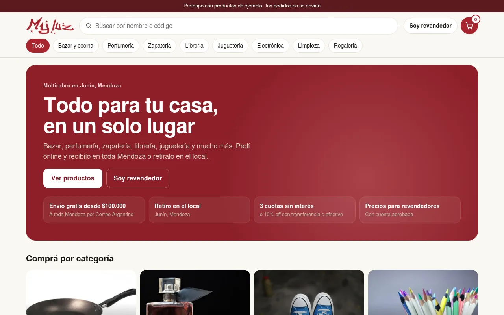
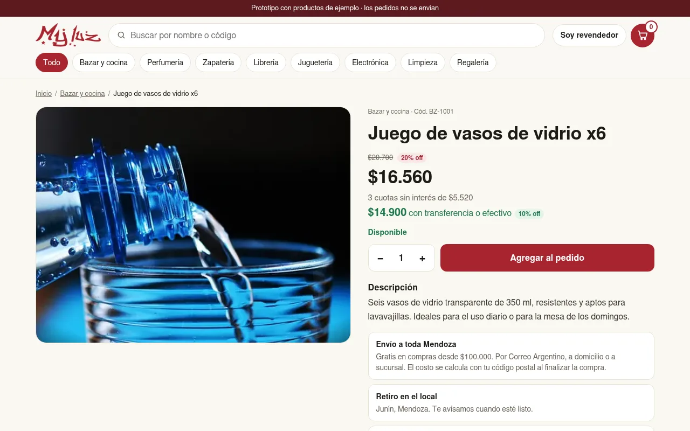
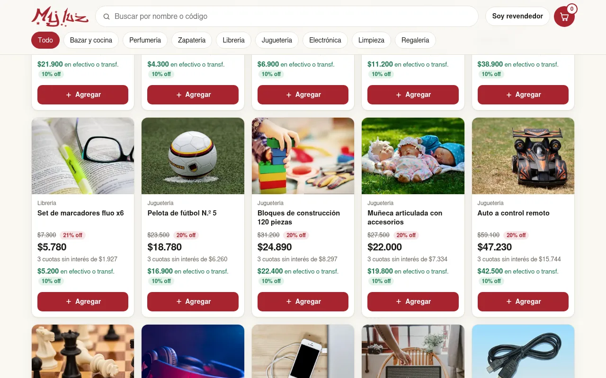
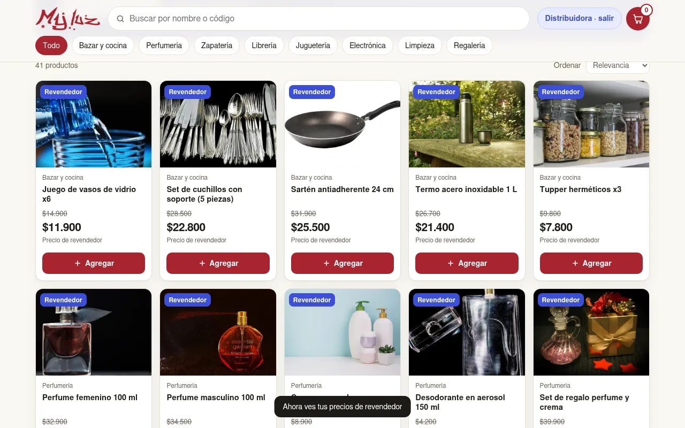
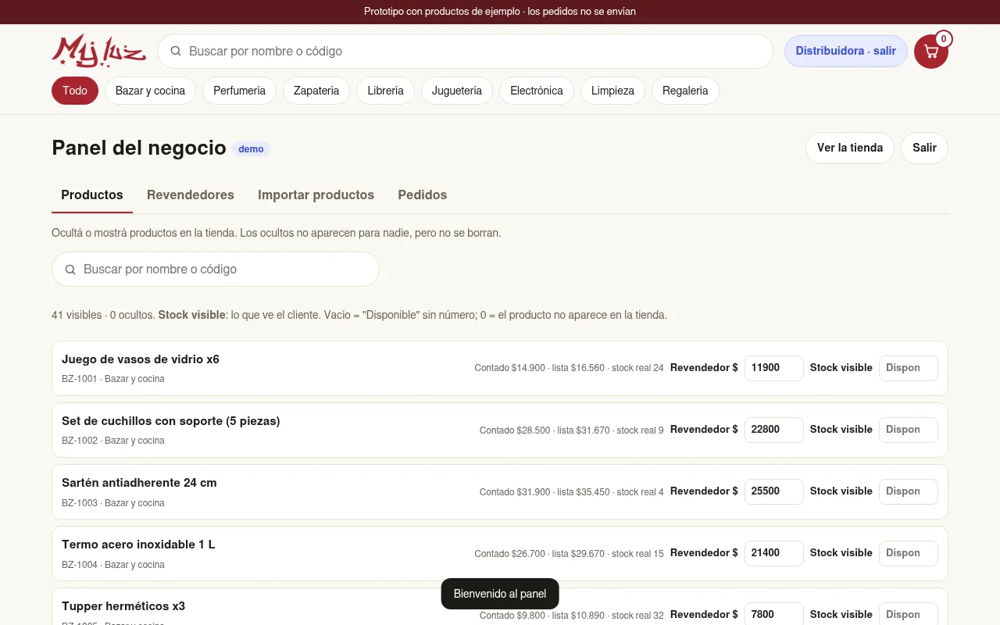
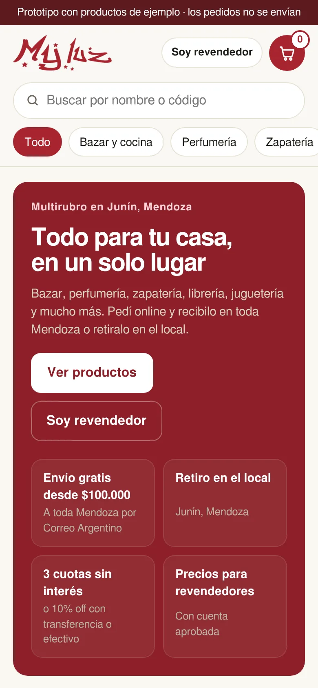

# Myluz · tienda online

Tienda online de **Myluz** (calzado y accesorios, Junín, Mendoza): precios de contado y en 3 cuotas sin interés, cuentas de revendedores con precio propio, envíos por Correo Argentino a toda Mendoza y panel para el dueño.

Hecha por [mortups](https://mortups.com.ar) sobre Next.js 14, Supabase y Cloudflare Workers.

## Cómo se ve

<table>
<tr>
<td width="50%"></td>
<td width="50%"></td>
</tr>
<tr>
<td align="center"><sub>Portada</sub></td>
<td align="center"><sub>Producto: tachado, lista, 3 cuotas sin interés y 10 % off con transferencia</sub></td>
</tr>
<tr>
<td width="50%"></td>
<td width="50%"></td>
</tr>
<tr>
<td align="center"><sub>Catálogo</sub></td>
<td align="center"><sub>Revendedor aprobado: ve su precio fijo</sub></td>
</tr>
<tr>
<td width="50%"></td>
<td width="50%" align="center"></td>
</tr>
<tr>
<td align="center"><sub>Panel del negocio: precio de revendedor y stock visible</sub></td>
<td align="center"><sub>En el celular</sub></td>
</tr>
</table>

<sub>Capturas del diseño aprobado (carpeta <code>prototipo/</code>, publicado en myluz.com.ar). La tienda real mantiene esta misma estética.</sub>

## Desarrollo
```bash
cp .env.local.example .env.local   # completar
npm install
npm run dev
```
Verificación: `npm run typecheck && npm run lint && npm test && npm run build`.

## Licencia
Todos los derechos reservados (ver LICENSE).
