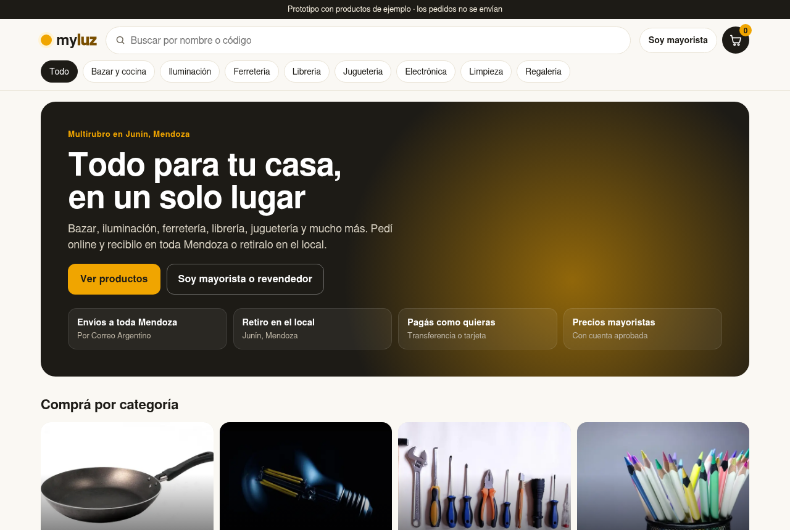
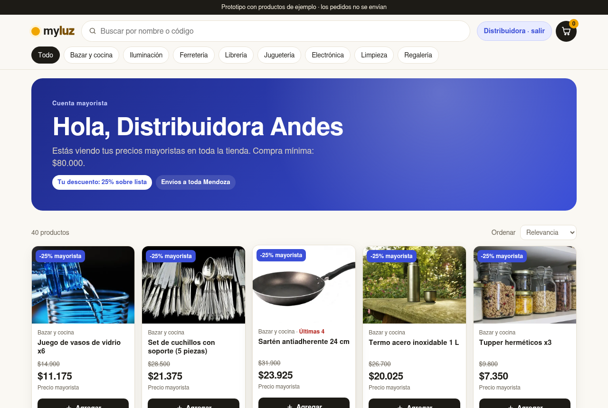
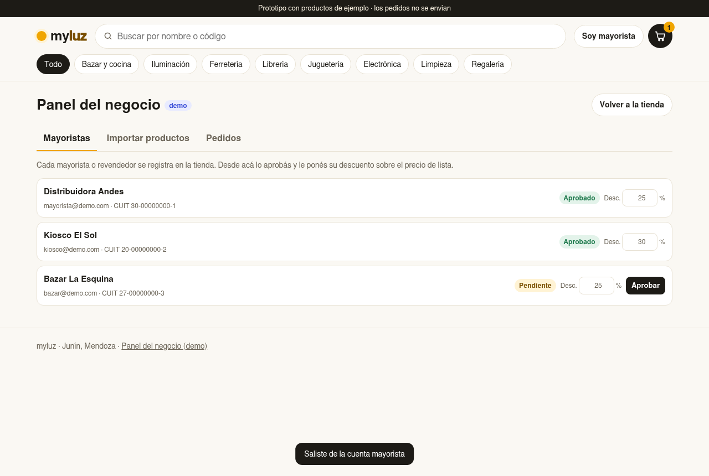

<div align="center">

# ☀️ myluz

**Tienda online para un comercio multirubro de Mendoza, con precios para público y para mayoristas en la misma página.**

[](#-roadmap)
[](https://mortups.com.ar)
[](https://workers.cloudflare.com)
[](#-stack)



</div>

---

## ✨ Qué hace

| | |
|---|---|
| 🛒 **Catálogo y carrito** | Categorías, buscador por nombre o código, orden por precio y carrito que se guarda en el navegador. |
| 🧾 **Página de cada producto** | Foto grande, descripción, disponibilidad, cantidad y productos relacionados, con dirección propia para compartir. |
| 🏷️ **Precios claros** | El público ve el precio de lista. Los descuentos que se muestran son siempre reales. |
| 🔐 **Mayoristas y revendedores** | Se registran, el negocio los aprueba y, al entrar, ven **su** precio en la misma tienda. Compra mínima configurable. |
| 🎚️ **Panel del negocio** | Con usuario y contraseña: ocultar o mostrar productos, aprobar mayoristas y ponerle a cada uno su descuento, ver pedidos. |
| 📦 **Importación desde el programa del negocio** | Se sube el archivo exportado (CSV) y se actualizan productos, precios y stock. |
| 🚚 **Envío calculado** | Costo de Correo Argentino a domicilio o a sucursal según código postal, peso y medidas (peso volumétrico incluido). Mismo motor que una tienda en producción, con pruebas automáticas. Retiro en el local sin costo. |
| 💳 **Pago** | Transferencia o tarjeta (Mercado Pago). |
| ⚖️ **Legales argentinos** | Términos y condiciones, privacidad (Ley 25.326), cambios y garantía, condiciones para mayoristas, botón de arrepentimiento y enlace a Defensa del Consumidor. |
| 📱 **Pensada para el celular** | Se usa cómoda con una mano; anda igual en la compu. |

<table>
<tr>
<td width="50%"></td>
<td width="50%"></td>
</tr>
<tr>
<td align="center"><sub>Un mayorista aprobado ve su precio</sub></td>
<td align="center"><sub>El negocio aprueba cuentas y define descuentos</sub></td>
</tr>
</table>

## 🧮 Cómo se calculan los precios

```text
precio de lista ──┬── público   → precio de lista
                  └── mayorista → lista tachada + su precio (lista − descuento del cliente, lo define el negocio)
```

Descuentos por medio de pago, recargos y compra mínima se definen con el negocio y son configurables.

## 🧰 Stack

- **Hoy (prototipo):** HTML, CSS y JavaScript sin dependencias ni build, servido como archivos estáticos en **Cloudflare Workers**.
- **Versión real:** Next.js + Supabase (base de datos y cuentas) + Cloudflare, sobre la misma base que ya funciona en otra tienda en producción de mortups.

```text
public/
├── index.html   # estructura de la tienda y del panel
├── styles.css   # diseño (mobile first)
├── app.js       # catálogo, precios, carrito, cuentas mayoristas y panel
├── envio.js     # cálculo de envío de Correo Argentino (probado en tests/)
├── data.js      # productos y descripciones de EJEMPLO
├── legales/     # páginas legales (se generan con tools/legales.py)
├── img/p/       # fotos de ejemplo (Pixabay, ver docs/CREDITOS.md)
└── _headers     # cabeceras de seguridad (CSP, noindex, etc.)
```

## 🚀 Probarlo en tu compu

```bash
npm run check    # sintaxis + pruebas (envío)
npm run dev      # servidor local con Wrangler
```

O abrí `public/index.html` directamente en el navegador.

| Para entrar como | Dónde | Datos de prueba |
|---|---|---|
| Mayorista | Botón "Soy mayorista" | `mayorista@demo.com` + cualquier contraseña |
| Negocio (panel) | Pie de página o `/#panel` | usuario `admin`, contraseña `demo` |

> En el prototipo los accesos son de muestra (todo corre en el navegador y no hay datos reales). En la versión real, las cuentas y el panel van con autenticación en el servidor.

## 🗺️ Roadmap

- [x] Prototipo navegable: catálogo, carrito, mayoristas, panel e importación.
- [ ] Definir con el negocio: descuentos, compra mínima, stock visible, cobros y envíos.
- [ ] Base de datos y cuentas reales (Supabase) con aprobación de mayoristas.
- [ ] Importación desde el programa del negocio con actualización frecuente de stock.
- [ ] Cobro con Mercado Pago y avisos de pedidos al negocio.
- [ ] Publicación en el dominio propio.

## 🔒 Seguridad y privacidad

- Este repo **no contiene claves, contraseñas ni datos reales** del negocio o de sus clientes. Los productos son de ejemplo.
- Los archivos exportados del sistema del negocio nunca se suben (`datos/` y `*.csv` están en `.gitignore`).
- El sitio de prueba no se indexa en buscadores y usa una política de contenido estricta (`public/_headers`).

## 📄 Licencia

Código público para mostrar el trabajo, **con todos los derechos reservados**. Ver [LICENSE](LICENSE).

<div align="center"><sub>Hecho con ☕ en Mendoza por <a href="https://mortups.com.ar">mortups</a></sub></div>
